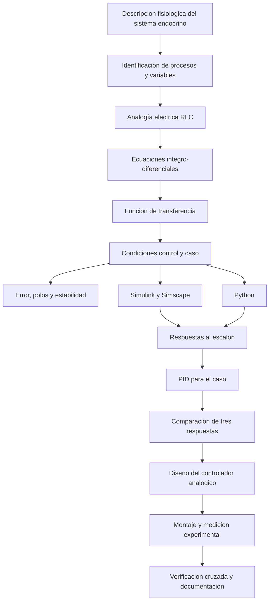

[](https://matlab.mathworks.com/open/github/v1?repo=DrPaulValle/MSF-IBF1020)

# Práctica 4 --- Modelado y control del sistema endócrino

Repositorio académico de la asignatura **Modelado de Sistemas
Fisiológicos**, del programa de **Ingeniería Biomédica** del Tecnológico
Nacional de México / Instituto Tecnológico de Tijuana. Esta práctica
desarrolla el modelado de un sistema endócrino simplificado mediante una
analogía eléctrica de segundo orden, el análisis de su respuesta
dinámica y el diseño de un controlador clásico.

Se compara una condición de referencia (**control**) con una condición
alterada (**caso**), representadas mediante circuitos RLC con diferentes
valores de capacitancia y resistencia. Se construyen modelos en
MATLAB/Simulink, Simscape Electrical y Python; posteriormente, se diseña
y sintoniza un controlador PID, se plantea su implementación analógica
con amplificadores operacionales y se contrastan los resultados
computacionales con mediciones experimentales en el Laboratorio de
Electrónica.

**Docente:** Dr. Paul Antonio Valle Trujillo\
**Correo:** paul.valle@tectijuana.edu.mx\
**Departamento:** Ingeniería Eléctrica y Electrónica\
**Institución:** Tecnológico Nacional de México / Instituto Tecnológico
de Tijuana\
**Asignatura:** Modelado de Sistemas Fisiológicos\
**Programa:** Ingeniería Biomédica\
**Estudiante:** Nombre completo · Número de control ·
correo@tijuana.tecnm.mx

**Repositorio de la asignatura:**
https://github.com/DrPaulValle/MSF-IBF1020\
**Sede:** Blvd. Alberto Limón Padilla s/n, Tijuana, C. P. 22454, B. C.,
México.

------------------------------------------------------------------------

## Contenido

1.  [Resumen](#resumen)
2.  [Competencia y objetivos](#competencia-y-objetivos)
3.  [Relación con el temario](#relacion-con-el-temario)
4.  [Modelo fisiológico y analogía eléctrica](#modelo-fisiologico-y-analogia-electrica)
5.  [Formulación matemática](#formulacion-matematica)
6.  [Análisis temporal y de estabilidad](#analisis-temporal-y-de-estabilidad)
7.  [Señales de entrada y condiciones de simulación](#senales-de-entrada-y-condiciones-de-simulacion)
8.  [Implementación en MATLAB, Simulink y Simscape](#implementacion-en-matlab-simulink-y-simscape)
9.  [Control en lazo cerrado y sintonización PID](#control-en-lazo-cerrado-y-sintonizacion-pid)
10. [Reproducción en Python](#reproduccion-en-python)
11. [Implementación experimental y controlador analógico](#implementacion-experimental-y-controlador-analogico)
12. [Resultados y verificación cruzada](#resultados-y-verificacion-cruzada)
13. [Flujo de trabajo](#flujo-de-trabajo)
14. [Actividades del estudiante](#actividades-del-estudiante)
15. [Estructura del repositorio](#estructura-del-repositorio)
16. [Requisitos](#requisitos)
17. [Reproducibilidad y entregables](#reproducibilidad-y-entregables)
18. [Referencias](#referencias)

------------------------------------------------------------------------

## Resumen

El sistema endócrino regula diversos procesos fisiológicos mediante la
secreción de hormonas, su transporte por la circulación y su interacción
con tejidos u órganos diana. Para estudiar su comportamiento dinámico,
la práctica utiliza un modelo fenomenológico simplificado en el que un
estímulo fisiológico inicia la secreción hormonal y la señal atraviesa
procesos equivalentes de transporte, almacenamiento y respuesta.

La analogía eléctrica considera una fuente de voltaje de entrada
$V_e(t)$, una resistencia $R_1$, un capacitor $C$ conectado a la
referencia y una rama formada por un inductor $L$ y una resistencia
$R_2$ en serie. La salida $V_s(t)$ se mide en el nodo posterior a $R_1$,
donde se unen el capacitor y la rama $L$--$R_2$. Los flujos de entrada y
salida se representan mediante $F_e(t)$ y $F_s(t)$, respectivamente.

Se comparan dos configuraciones: una condición de referencia, denominada
**control**, y una condición alterada, denominada **caso**. La entrada
es un escalón unitario y las respuestas se estudian durante
$0\leq t\leq10\,\mathrm{s}$. La respuesta del control se utiliza como
referencia para diseñar un PID que reduzca la diferencia con respecto al
caso. Finalmente, se plantea la implementación física de los circuitos y
del controlador analógico para comparar los resultados experimentales
con las simulaciones.

**Palabras clave:** sistema endócrino; secreción hormonal; transporte
hormonal; analogía eléctrica; circuito RLC; sistema de segundo orden;
capacitancia; inductancia; resistencia; función de transferencia;
respuesta al escalón; estabilidad; controlador PID; Simscape Electrical;
experimentación *in silico*; verificación experimental.

[Volver al contenido](#contenido)

------------------------------------------------------------------------

## Competencia y objetivos

### Competencia a desarrollar

Modelizar sistemas fisiológicos mediante analogías eléctricas,
ecuaciones diferenciales y funciones de transferencia para analizar su
comportamiento dinámico y diseñar estrategias de control mediante
técnicas de control clásico. En esta práctica se interpreta una
descripción simplificada de los procesos de secreción, transporte,
almacenamiento y respuesta hormonal para proponer un circuito eléctrico
equivalente de segundo orden. Se comparan una condición de referencia y
una condición alterada, se diseña un controlador PID y se contrastan los
resultados mediante modelado analítico, simulación computacional y
experimentación en el Laboratorio de Electrónica.

### Objetivo general

Modelar y analizar la dinámica de un sistema endócrino simplificado
mediante un circuito eléctrico equivalente de segundo orden, comparar
las respuestas de las condiciones control y caso, e implementar un
controlador PID que permita aproximar la respuesta del caso a la
respuesta de referencia.

### Objetivos específicos

-   Identificar los procesos fisiológicos simplificados de estímulo,
    secreción, transporte, almacenamiento y respuesta hormonal.
-   Establecer la correspondencia entre las variables fisiológicas y los
    elementos eléctricos $V_e(t)$, $F_e(t)$, $R_1$, $C$, $L$, $R_2$,
    $F_s(t)$ y $V_s(t)$.
-   Construir los circuitos equivalentes para las condiciones control y
    caso con los valores indicados en el syllabus.
-   Formular las ecuaciones integro-diferenciales y obtener las
    funciones de transferencia $G_{\mathrm{control}}(s)$ y
    $G_{\mathrm{caso}}(s)$.
-   Calcular el error en estado estacionario, los polos y la estabilidad
    de ambas condiciones.
-   Simular las respuestas ante un escalón unitario en el intervalo de 0
    a 10 segundos.
-   Implementar las representaciones mediante ecuaciones, función de
    transferencia y circuito equivalente en MATLAB/Simulink y Simscape
    Electrical.
-   Diseñar y sintonizar un controlador PID tomando la respuesta del
    control como referencia.
-   Reproducir las respuestas mediante Python y comparar los resultados
    entre plataformas.
-   Calcular los componentes de un controlador PID analógico, construir
    los circuitos en protoboard y verificar su funcionamiento con el
    generador de funciones y el osciloscopio.
-   Documentar los modelos, cálculos, simulaciones, evidencias
    experimentales y conclusiones en GitHub.

[Volver al contenido](#contenido)

------------------------------------------------------------------------

## Relación con el temario

  -----------------------------------------------------------------------
  Unidad                  Área                    Contenidos aplicados
  ----------------------- ----------------------- -----------------------
  I                       Sistemas de control     Respuesta temporal,
                          retroalimentados        error en estado
                                                  estacionario, polos,
                                                  estabilidad y
                                                  retroalimentación

  II                      Modelado matemático     Analogía eléctrica,
                                                  circuito RLC,
                                                  ecuaciones
                                                  integro-diferenciales y
                                                  funciones de
                                                  transferencia

  III                     Controladores           Control PID,
                                                  sintonización de
                                                  ganancias y comparación
                                                  entre lazo abierto y
                                                  lazo cerrado
  -----------------------------------------------------------------------

La práctica relaciona fisiología endócrina, circuitos eléctricos,
modelado matemático, electrónica analógica y simulación computacional.

[Volver al contenido](#contenido)

------------------------------------------------------------------------

## Modelo fisiológico y analogía eléctrica

### Representación del sistema endócrino

La práctica describe un sistema endócrino simplificado. Un estímulo
fisiológico activa la secreción hormonal; la señal es transportada desde
la glándula hasta un compartimento de respuesta, donde puede acumularse
temporalmente y posteriormente ser utilizada o eliminada. La respuesta
del tejido u órgano diana presenta una dinámica que no necesariamente
ocurre de manera instantánea.

La siguiente imagen corresponde a la representación del sistema
endócrino que se integrará al repositorio.


**Figura 1.** Representación del sistema endócrino. *La imagen debe
encontrarse en la raíz del repositorio con el nombre exacto
`Sistema endocrino.png`.*

### Circuito eléctrico equivalente

De acuerdo con la descripción de la **sección 5.6.2 del syllabus
(pp. 96--99)**, el circuito equivalente se construye con una rama
principal formada por la fuente $V_e(t)$ y el resistor $R_1$. Después de
$R_1$ se encuentra el nodo de salida $V_s(t)$. Desde ese nodo se
conectan en paralelo dos ramas hacia la referencia:

-   Una rama formada por el capacitor $C$.
-   Una segunda rama formada por el inductor $L$ y el resistor $R_2$
    conectados en serie.

La salida $V_s(t)$ se mide en el nodo de unión entre $R_1$, $C$ y $L$.
Los elementos independientes de almacenamiento de energía son $C$ y $L$,
por lo que el circuito representa un sistema dinámico de segundo orden.

### Correspondencia fisiológica y eléctrica

  -----------------------------------------------------------------------
  Variable o proceso      Representación          Interpretación dentro
  fisiológico             eléctrica               del modelo
  ----------------------- ----------------------- -----------------------
  Estímulo para la        $V_e(t)$                Señal de entrada que
  secreción hormonal                              activa la respuesta del
                                                  sistema endócrino

  Flujo de secreción y    $F_e(t)$                Corriente asociada con
  transporte hormonal                             la transferencia de la
                                                  señal desde la fuente

  Pérdidas y oposición    $R_1$                   Representación
  durante el transporte                           fenomenológica de
                                                  procesos que reducen o
                                                  retardan la transmisión

  Acumulación temporal de $C$                     Capacidad del
  hormona                                         compartimento para
                                                  almacenar temporalmente
                                                  la señal

  Retardo o inercia de la $L$                     Representación de la
  respuesta del tejido                            resistencia dinámica
  diana                                           ante cambios rápidos

  Utilización, disipación $R_2$                   Oposición efectiva
  o eliminación de la                             asociada con la
  señal                                           utilización o
                                                  desaparición de la
                                                  señal

  Flujo asociado con la   $F_s(t)$                Corriente
  respuesta del tejido                            correspondiente a la
  diana                                           rama que representa la
                                                  respuesta del órgano
                                                  diana

  Nivel hormonal efectivo $V_s(t)$                Salida que representa
                                                  de manera normalizada
                                                  la señal disponible en
                                                  el compartimento de
                                                  interés
  -----------------------------------------------------------------------

Estas correspondencias constituyen una **analogía fenomenológica con
fines académicos**. Los valores y unidades de los componentes eléctricos
no representan directamente magnitudes fisiológicas medidas en un
sistema endócrino real. El modelo tampoco representa un eje hormonal
específico.

### Parámetros del circuito equivalente

Los valores comerciales especificados en la práctica son:

  Componente     Control      Caso
  ------------ --------- ---------
  $R_1$             1 kΩ      1 kΩ
  $L$             100 mH    100 mH
  $C$               1 µF   1000 µF
  $R_2$           100 kΩ      1 kΩ

La condición alterada modifica simultáneamente la capacitancia $C$ y la
resistencia $R_2$. Esto permite estudiar cómo los cambios en el
almacenamiento y la disipación afectan la respuesta temporal del
circuito. Los valores son parámetros del modelo eléctrico y no
mediciones clínicas.

[Volver al contenido](#contenido)

------------------------------------------------------------------------
## Formulación matemática
### Variables del modelo

-   $V_e(t)$: voltaje de entrada que representa el estímulo fisiológico.
-   $V_s(t)$: voltaje de salida medido en el nodo posterior a $R_1$.
-   $F_e(t)$: flujo de entrada asociado con la secreción y el transporte
    hormonal.
-   $F_s(t)$: flujo de salida asociado con la respuesta del tejido
    diana.
-   $R_1$: resistencia equivalente a las pérdidas y oposición durante el
    transporte.
-   $C$: capacitancia equivalente al almacenamiento temporal de la
    señal.
-   $L$: inductancia equivalente al retardo o inercia de la respuesta.
-   $R_2$: resistencia equivalente a la utilización, disipación o
    eliminación de la señal.

### Relaciones del circuito

Para la rama capacitiva:

$$F_C(t)=C\frac{dV_s(t)}{dt}.$$

Para la rama formada por el inductor y la resistencia en serie:

$$V_s(t)=L\frac{dF_s(t)}{dt}+R_2F_s(t).$$

En el resistor de entrada:

$$V_e(t)-V_s(t)=R_1F_e(t).$$

En el nodo de salida, aplicando la ley de corrientes de Kirchhoff:

$$F_e(t)=F_C(t)+F_s(t).$$

Por lo tanto, la ecuación del nodo puede escribirse como:

$$\frac{V_e(t)-V_s(t)}{R_1}=C\frac{dV_s(t)}{dt}+F_s(t).$$

Estas relaciones describen el circuito indicado en la sección 5.6.2. La
formulación debe conservar la topología del capacitor en paralelo con la
rama serie $L$--$R_2$.

### Función de transferencia

Aplicando la transformada de Laplace con condiciones iniciales nulas, la
impedancia de la rama formada por $L$ y $R_2$ es:

$$Z_{LR_2}(s)=sL+R_2.$$

La impedancia equivalente de las dos ramas en paralelo es:

$$Z_p(s)=\frac{\frac{1}{sC}(sL+R_2)}{\frac{1}{sC}+(sL+R_2)}
=\frac{sL+R_2}{sC(sL+R_2)+1}.$$

Mediante el divisor de voltaje entre $R_1$ y la impedancia equivalente
$Z_p(s)$:

$$G(s)=\frac{V_s(s)}{V_e(s)}=\frac{Z_p(s)}{R_1+Z_p(s)}.$$

Al simplificar:

$$\boxed{G(s)=\frac{V_s(s)}{V_e(s)}
=\frac{Ls+R_2}{R_1LCs^2+(R_1R_2C+L)s+(R_1+R_2)}}.$$

La función de transferencia es de segundo orden debido a los dos
elementos independientes de almacenamiento de energía: el capacitor $C$
y el inductor $L$.

### Funciones para control y caso

Sustituir los valores de cada condición en la expresión general permite
obtener:

$$G_{\mathrm{control}}(s)=
\frac{L_{\mathrm{control}}s+R_{2,\mathrm{control}}}
{R_{1,\mathrm{control}}L_{\mathrm{control}}C_{\mathrm{control}}s^2+
(R_{1,\mathrm{control}}R_{2,\mathrm{control}}C_{\mathrm{control}}+L_{\mathrm{control}})s+
(R_{1,\mathrm{control}}+R_{2,\mathrm{control}})}.$$

$$G_{\mathrm{caso}}(s)=
\frac{L_{\mathrm{caso}}s+R_{2,\mathrm{caso}}}
{R_{1,\mathrm{caso}}L_{\mathrm{caso}}C_{\mathrm{caso}}s^2+
(R_{1,\mathrm{caso}}R_{2,\mathrm{caso}}C_{\mathrm{caso}}+L_{\mathrm{caso}})s+
(R_{1,\mathrm{caso}}+R_{2,\mathrm{caso}})}.$$

La expresión debe evaluarse utilizando unidades consistentes en ohms,
farads y henrys. Se recomienda conservar por separado los valores
originales y los coeficientes numéricos utilizados en MATLAB y Python
para evitar errores de conversión.

[Volver al contenido](#contenido)

------------------------------------------------------------------------

## Análisis temporal y de estabilidad

### Error en estado estacionario

La entrada de la práctica es un escalón unitario. Para cada función de
transferencia se debe determinar la respuesta final y calcular el error
en estado estacionario correspondiente. La comparación permite observar
las diferencias entre la condición control y la condición caso.

Para un sistema estable, el valor final puede analizarse mediante el
teorema del valor final:

$$\lim_{t\to\infty}V_s(t)=\lim_{s\to0}sV_s(s).$$

Con un escalón unitario, $V_e(s)=1/s$. El análisis debe realizarse para
cada conjunto de parámetros y verificando previamente las condiciones de
estabilidad.

### Polos y estabilidad

Obtener los polos de $G_{\mathrm{control}}(s)$ y $G_{\mathrm{caso}}(s)$
a partir de las raíces del denominador. Representar su ubicación en el
plano complejo y determinar la estabilidad de ambas condiciones.

Analizar el efecto de modificar $C$ y $R_2$ sobre la posición de los
polos, el amortiguamiento y la rapidez de respuesta. Relacionar los
resultados con el comportamiento esperado del circuito.

### Bosquejo y comparación temporal

Antes de ejecutar las simulaciones, elaborar un bosquejo cualitativo de
las respuestas al escalón tomando en cuenta los polos, la estabilidad y
el error estacionario. Posteriormente, comparar los bosquejos con las
respuestas obtenidas mediante MATLAB/Simulink, Simscape Electrical y
Python.

[Volver al contenido](#contenido)

------------------------------------------------------------------------

## Señales de entrada y condiciones de simulación

La entrada utilizada durante la práctica es un **escalón unitario**:

$$V_e(t)=u(t).$$

Esta señal representa un estímulo sostenido aplicado al sistema. Las
simulaciones de lazo abierto y lazo cerrado deben realizarse durante el
intervalo:

$$t\in[0,10]\,\mathrm{s}.$$

Para que la comparación sea válida, las condiciones control y caso deben
utilizar la misma entrada, intervalo temporal y condiciones iniciales.
El syllabus no establece un paso de integración único para todas las
plataformas; por ello, la configuración numérica debe documentarse y
mantenerse consistente en las comparaciones.

[Volver al contenido](#contenido)

------------------------------------------------------------------------

## Implementación en MATLAB, Simulink y Simscape

Para las condiciones **control** y **caso** se construyen tres
representaciones del sistema:

  -----------------------------------------------------------------------
  Implementación          Descripción             Verificación
  ----------------------- ----------------------- -----------------------
  Modelo de ecuaciones    Bloques que representan Concordancia con las
  integro-diferenciales   las relaciones          ecuaciones obtenidas
                          dinámicas del circuito  mediante Kirchhoff

  Función de              Planta obtenida         Correspondencia entre
  transferencia           mediante la             entrada y salida
                          transformada de Laplace 

  Simscape Electrical     Circuito RLC            Comparación con las
                          equivalente con los     representaciones
                          valores de cada         matemáticas
                          condición               
  -----------------------------------------------------------------------

Se aplica un escalón unitario a cada modelo y se comparan las salidas
$V_{s,\mathrm{control}}(t)$ y $V_{s,\mathrm{caso}}(t)$. Las tres
representaciones deben utilizar los mismos parámetros y condiciones
iniciales.

En un cuaderno MATLAB se deben ejecutar los modelos y recuperar en el
*Workspace* las señales del **control**, **caso en lazo abierto** y
**caso con PID**. Una función de graficación debe identificar las
variables y sus unidades, comparar las respuestas y guardar las figuras
obtenidas en formato PDF.

[Volver al contenido](#contenido)

------------------------------------------------------------------------

## Control en lazo cerrado y sintonización PID

La respuesta del sistema en condición **control** se utiliza como
referencia para la condición **caso**, de acuerdo con el esquema de la
**Figura 5.5 del syllabus (p. 98)**. La señal de error se define como:

$$e(t)=V_{s,\mathrm{control}}(t)-V_{s,\mathrm{caso}}(t).$$

Se incorpora el bloque **PID Controller** de Simulink al modelo del
caso. Mediante la herramienta **Tune** se determinan las ganancias
proporcional, integral y derivativa:

$$k_P,\qquad k_I,\qquad k_D.$$

La ley de control PID ideal se expresa como:

$$u(t)=k_Pe(t)+k_I\int_0^t e(\tau)\,d\tau+k_D\frac{de(t)}{dt}.$$

El objetivo es reducir la diferencia entre la salida del caso y la
respuesta de referencia, buscando una respuesta estable. Después de la
sintonización se comparan:

-   $V_{s,\mathrm{control}}(t)$: respuesta de referencia.
-   $V_{s,\mathrm{caso}}(t)$: respuesta del caso en lazo abierto.
-   $V_{s,\mathrm{PID}}(t)$: respuesta del caso con el controlador.

Se deben registrar las ganancias obtenidas, la configuración utilizada
en Tune y las evidencias de la respuesta controlada. No se deben asignar
ganancias ni afirmar mejoras numéricas antes de ejecutar la
sintonización y las simulaciones.

[Volver al contenido](#contenido)

------------------------------------------------------------------------

## Reproducción en Python

En **Visual Studio Code** se implementan las funciones de transferencia
correspondientes al control y al caso. Se obtienen sus respuestas al
escalón unitario durante el intervalo de 0 a 10 segundos, utilizando los
mismos parámetros que en MATLAB/Simulink.

Posteriormente, se incorporan las ganancias $k_P$, $k_I$ y $k_D$
obtenidas mediante la herramienta Tune para construir el modelo del caso
en lazo cerrado. El programa debe generar y guardar las figuras que
permitan comparar las respuestas del control, del caso y del caso con
PID.

La implementación en Python debe permitir verificar la consistencia de
los resultados con MATLAB/Simulink. Se deben documentar las bibliotecas
utilizadas, las condiciones de simulación y cualquier diferencia
observada entre plataformas.

[Volver al contenido](#contenido)

------------------------------------------------------------------------

## Implementación experimental y controlador analógico

A diferencia de una práctica exclusivamente computacional, esta
actividad también contempla la construcción física de los circuitos
correspondientes al control y al caso en el **Laboratorio de
Electrónica**.

### Circuitos en lazo abierto

Construir en protoboard los circuitos RLC de ambas condiciones
utilizando los valores comerciales especificados. Configurar el
generador de funciones para producir una aproximación experimental al
escalón unitario y utilizar el osciloscopio para registrar
simultáneamente la entrada $V_e(t)$ y la salida $V_s(t)$.

Guardar las capturas del osciloscopio y comparar las respuestas
experimentales de los dos circuitos con las simulaciones.

### Diseño e implementación del controlador analógico

Las ganancias $k_P$, $k_I$ y $k_D$ obtenidas mediante la sintonización
se utilizan como especificaciones para calcular los resistores y
capacitores necesarios para implementar un controlador PID mediante
amplificadores operacionales.

Antes de construirlo físicamente, se debe seleccionar valores
comerciales apropiados y verificar el circuito del controlador mediante
**Simscape Electrical**. Posteriormente, construir el controlador
analógico y conectarlo al circuito correspondiente al caso. Configurar
la alimentación simétrica de los amplificadores operacionales de acuerdo
con las especificaciones del laboratorio.

Registrar las respuestas en lazo abierto y en lazo cerrado y compararlas
con la respuesta del bloque ideal **PID Controller**.

### Comparación entre simulación y experimentación

Analizar las diferencias entre los resultados experimentales y los
obtenidos mediante MATLAB/Simulink, Simscape Electrical y Python.
Considerar, entre otros factores:

-   Tolerancias de resistores, capacitores e inductores.
-   Resistencia interna y comportamiento no ideal del inductor.
-   Tolerancia y resistencia serie equivalente del capacitor.
-   Valores comerciales seleccionados para implementar el controlador.
-   Características no ideales de los amplificadores operacionales.
-   Limitaciones de los instrumentos de medición.
-   Aproximación experimental utilizada para generar el escalón.

[Volver al contenido](#contenido)

------------------------------------------------------------------------

## Resultados y verificación cruzada

Se deben comparar las respuestas obtenidas para la condición control, la
condición caso y el caso con PID. La verificación debe considerar tanto
los modelos computacionales como los circuitos experimentales.

  -----------------------------------------------------------------------------
  Evidencia               Control           Caso              Caso con PID
  ----------------------- ----------------- ----------------- -----------------
  Ecuaciones              Respuesta al      Respuesta al      Modelo controlado
  integro-diferenciales   escalón           escalón           
  en Simulink                                                 

  Función de              Respuesta al      Respuesta al      Respuesta
  transferencia           escalón           escalón           controlada

  Simscape Electrical     Circuito RLC      Circuito RLC      Circuito con
                          equivalente       equivalente       controlador,
                                                              según
                                                              implementación

  Cuaderno MATLAB         Figura            Figura            Figura
                          comparativa       comparativa       comparativa

  Python                  Figura            Figura            Figura
                          comparativa       comparativa       comparativa

  Laboratorio de          Medición del      Medición del      Medición con
  Electrónica             circuito          circuito          controlador
                                                              analógico
  -----------------------------------------------------------------------------

### Discusión de resultados

-   Explicar cómo la modificación de $C$ y $R_2$ afecta la dinámica del
    sistema.
-   Comparar el error en estado estacionario y la ubicación de los polos
    de ambas condiciones.
-   Verificar la correspondencia entre las ecuaciones, las funciones de
    transferencia y los circuitos equivalentes.
-   Analizar las diferencias entre las respuestas de control y caso ante
    el escalón unitario.
-   Evaluar si el PID aproxima la salida del caso a la respuesta de
    referencia.
-   Comparar el controlador ideal de Simulink con el controlador
    analógico implementado mediante amplificadores operacionales.
-   Identificar las diferencias entre los resultados simulados y
    experimentales y relacionarlas con las no idealidades de los
    componentes y los instrumentos.

**Pendiente de completar con evidencias reales:** polos calculados,
errores estacionarios, ganancias PID, valores de componentes del
controlador, gráficas, capturas del osciloscopio, comparación entre
plataformas, discusión y conclusiones. No se incluyen resultados
experimentales ficticios.

[Volver al contenido](#contenido)

------------------------------------------------------------------------

## Flujo de trabajo



La secuencia conecta la interpretación fisiológica, el modelo eléctrico,
el análisis matemático, la simulación, el diseño del controlador y la
comprobación experimental.

[Volver al contenido](#contenido)

------------------------------------------------------------------------

## Actividades del estudiante

### Etapa 1. Interpretación y modelo

-   [ ] Identificar el estímulo, el transporte, el almacenamiento y la
    respuesta hormonal representados.
-   [ ] Construir el circuito equivalente con $V_e(t)$, $R_1$, $C$, $L$,
    $R_2$ y $V_s(t)$.
-   [ ] Identificar los flujos $F_e(t)$ y $F_s(t)$, los nodos y la
    referencia eléctrica.
-   [ ] Construir los circuitos para las condiciones control y caso con
    los valores indicados.
-   [ ] Formular las ecuaciones integro-diferenciales y obtener las
    funciones de transferencia.

### Etapa 2. Análisis y simulación

-   [ ] Calcular el error en estado estacionario de ambas condiciones.
-   [ ] Obtener los polos y determinar la estabilidad de los sistemas.
-   [ ] Elaborar los bosquejos cualitativos de las respuestas al
    escalón.
-   [ ] Implementar ecuaciones, funciones de transferencia y circuitos
    en Simulink y Simscape Electrical.
-   [ ] Comparar las respuestas al escalón unitario de 0 a 10 segundos.

### Etapa 3. Control y verificación computacional

-   [ ] Utilizar la respuesta del control como referencia del caso.
-   [ ] Construir el sistema de retroalimentación e incorporar el bloque
    PID Controller.
-   [ ] Utilizar Tune para obtener $k_P$, $k_I$ y $k_D$.
-   [ ] Comparar control, caso y caso con PID.
-   [ ] Desarrollar el cuaderno MATLAB y guardar las figuras en PDF.
-   [ ] Reproducir las funciones de transferencia y el sistema
    controlado en Python.
-   [ ] Realizar la verificación cruzada entre MATLAB/Simulink, Simscape
    Electrical y Python.

### Etapa 4. Implementación experimental

-   [ ] Construir en protoboard los circuitos RLC de control y caso.
-   [ ] Configurar el generador de funciones y registrar $V_e(t)$ y
    $V_s(t)$ con el osciloscopio.
-   [ ] Calcular los componentes comerciales del controlador PID
    analógico.
-   [ ] Verificar el controlador mediante Simscape Electrical.
-   [ ] Construir el controlador con amplificadores operacionales e
    integrarlo al circuito del caso.
-   [ ] Registrar y comparar las respuestas en lazo abierto y lazo
    cerrado.
-   [ ] Analizar las diferencias entre simulación y experimentación.

### Etapa 5. Documentación

-   [ ] Agregar `Sistema endocrino.png` a la raíz del repositorio.
-   [ ] Integrar el circuito equivalente propuesto y su explicación.
-   [ ] Documentar ecuaciones, funciones de transferencia, polos y
    errores.
-   [ ] Incluir archivos de MATLAB, Simulink, Simscape Electrical y
    Python.
-   [ ] Agregar las ganancias PID y el cálculo de los componentes del
    controlador analógico.
-   [ ] Integrar fotografías de los montajes, capturas del osciloscopio
    y gráficas.
-   [ ] Completar la discusión, conclusiones, `README.md` y
    `CITATION.cff`.

[Volver al contenido](#contenido)

------------------------------------------------------------------------

## Estructura del repositorio

Organización **sugerida**, que debe adaptarse a los nombres de los
archivos reales:

``` text
.
├── README.md                         # Documentación de la práctica
├── CITATION.cff                      # Datos de citación
├── Apellido_NoControl.mlx            # Cuaderno MATLAB
├── Apellido_NoControl.pdf            # Exportación del cuaderno
├── endocrino.slx                     # Modelos de Simulink
├── endocrino_simscape.slx            # Circuitos equivalentes en Simscape
├── endocrino.py                      # Script de Python
├── Sistema endocrino.png             # Representación del sistema endócrino
├── figuras/
│   ├── escalon_matlab.pdf            # Comparación de respuestas en MATLAB
│   └── escalon_python.pdf            # Comparación de respuestas en Python
└── evidencias/
    ├── circuitos_control_caso/       # Fotografías de los circuitos RLC
    ├── controlador_pid/              # Diseño y montaje del PID analógico
    └── osciloscopio/                 # Capturas de las mediciones
```

**Los nombres de archivos y carpetas son propuestas**, no nombres
confirmados en el syllabus. Actualizar las rutas según los archivos
utilizados y eliminar las entradas que no existan antes de publicar el
repositorio.

[Volver al contenido](#contenido)

------------------------------------------------------------------------

## Requisitos

### Software

-   **MATLAB** y **Simulink** para el modelo, las funciones de
    transferencia y el controlador.
-   **Simscape Electrical** para los circuitos equivalentes y la
    verificación del controlador analógico.
-   Herramienta **Tune** del bloque `PID Controller`.
-   **Python** y **Visual Studio Code** para reproducir las
    simulaciones.
-   Bibliotecas de Python requeridas por el código desarrollado.
-   **Git y GitHub** para la entrega y documentación.

### Material y equipo de laboratorio

-   Protoboard y cables de conexión.
-   Resistores, capacitores e inductores con los valores comerciales
    especificados.
-   Amplificadores operacionales y componentes pasivos para el
    controlador PID.
-   Fuente de alimentación para los circuitos y alimentación simétrica
    para los amplificadores operacionales, según las especificaciones
    del laboratorio.
-   Generador de funciones.
-   Osciloscopio.

La práctica contempla tanto simulación computacional como construcción y
medición experimental. Los instrumentos y componentes deben configurarse
de acuerdo con las indicaciones del Laboratorio de Electrónica.

[Volver al contenido](#contenido)

------------------------------------------------------------------------

## Reproducibilidad y entregables

### Secuencia de reproducción

1.  Consultar el apartado 5.6 del syllabus, páginas 96--105.
2.  Interpretar la descripción funcional del sistema endócrino y
    construir el circuito RLC equivalente.
3.  Sustituir los valores de control y caso en el modelo y obtener sus
    funciones de transferencia.
4.  Calcular el error en estado estacionario, los polos y la
    estabilidad.
5.  Elaborar los bosquejos cualitativos de las respuestas al escalón.
6.  Implementar las ecuaciones, funciones de transferencia y circuitos
    en Simulink y Simscape Electrical.
7.  Simular el escalón unitario durante 0 a 10 segundos y comparar las
    respuestas.
8.  Diseñar y sintonizar el PID tomando el control como referencia del
    caso.
9.  Ejecutar el cuaderno MATLAB y reproducir los resultados en Python.
10. Calcular los componentes del controlador analógico y verificar su
    circuito mediante Simscape Electrical.
11. Construir los circuitos de control, caso y controlador en el
    laboratorio.
12. Registrar las respuestas con el osciloscopio y comparar simulación
    con experimentación.
13. Integrar las gráficas, cálculos, evidencias, discusión y
    conclusiones en GitHub.

  -----------------------------------------------------------------------
  Entregable                          Contenido
  ----------------------------------- -----------------------------------
  Interpretación fisiológica          Descripción del estímulo,
                                      transporte, almacenamiento y
                                      respuesta hormonal

  Circuito equivalente                Topología RLC, identificación de
                                      nodos, entrada, salida y flujos

  Desarrollo matemático               Ecuaciones integro-diferenciales y
                                      funciones de transferencia

  Análisis                            Error estacionario, polos,
                                      estabilidad y bosquejos

  Simulaciones                        Modelos de Simulink y circuitos en
                                      Simscape Electrical

  Control                             Diagrama de retroalimentación, PID
                                      y ganancias obtenidas

  MATLAB y Python                     Códigos, gráficas y verificación
                                      cruzada

  Controlador analógico               Cálculo de componentes, simulación
                                      y montaje con amplificadores
                                      operacionales

  Evidencia experimental              Fotografías de circuitos y capturas
                                      del osciloscopio

  Comparación                         Análisis de resultados
                                      computacionales y experimentales

  Documentación                       `README.md`, `CITATION.cff` y
                                      archivos complementarios
  -----------------------------------------------------------------------

### Criterios de presentación académica

Distinguir los parámetros del modelo eléctrico de las magnitudes
fisiológicas reales. Documentar los valores utilizados, las ganancias
obtenidas y las condiciones de simulación. Presentar únicamente gráficas
y mediciones que hayan sido generadas durante el desarrollo de la
práctica. Las diferencias entre simulación y experimentación deben
discutirse considerando las tolerancias y no idealidades de los
componentes y equipos.

[Volver al contenido](#contenido)

------------------------------------------------------------------------

## Referencias

\[1\] M. C. Khoo, *Physiological Control Systems: Analysis, Simulation,
and Estimation*, 2nd ed., IEEE Press, 2018.

\[2\] F. C. Hoppensteadt y C. S. Peskin, *Modeling and Simulation in
Medicine and the Life Sciences*, Springer.

\[3\] J. E. Hall, *Guyton and Hall Textbook of Medical Physiology*, 14th
ed., Elsevier, 2021.

\[4\] K. Ogata, *Ingeniería de Control Moderna*, 5.ª ed., Pearson
Educación, 2010.

\[5\] N. S. Nise, *Control Systems Engineering*, 8th ed., John Wiley &
Sons, 2020.

\[6\] P. A. Valle, *Syllabus para Modelado de Sistemas Fisiológicos*,
Tecnológico Nacional de México / Instituto Tecnológico de Tijuana, 2026,
apartado 5.6, pp. 96--105. https://biomath.xyz/course/

\[7\] Tecnológico Nacional de México, *Programa de estudio de la
asignatura Modelado de Sistemas Fisiológicos, IBF-1020*.

[Volver al contenido](#contenido)

------------------------------------------------------------------------

## Uso académico

Este repositorio documenta la práctica 5.6 de **Modelado y control del
sistema endócrino**. El circuito eléctrico constituye una analogía
fenomenológica simplificada con fines académicos; sus componentes no
representan mediciones fisiológicas directas ni describen un eje
hormonal específico.
